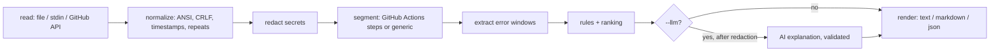

# ci-explain

Explain why your CI failed in seconds: evidence-first, works offline, secrets redacted, AI optional.

ci-explain reads the log of a failed CI build and explains common failure causes with the exact log lines
as evidence. The base analysis is deterministic, runs offline, and sends nothing anywhere.

> **Status: v0.1.0, early.** The rule catalog starts small (34 rules). It has only been tested on
> hand-written synthetic logs and on tool output reproduced locally, so nothing is claimed about accuracy on
> real-world logs. Step-aware parsing exists for GitHub Actions only; other CI logs are analyzed in a
> generic mode without step detection. The package is not published to npm yet: build it from source.

## Quick start (from source)

Requires Node.js 22.12 or newer.

```bash
git clone https://github.com/gggggggggg999/ci-explain.git
cd ci-explain
npm ci
npm run build

node dist/cli/main.js build.log
cat build.log | node dist/cli/main.js -
node dist/cli/main.js build.log --format markdown
node dist/cli/main.js build.log --format json
```

Analyze a failed GitHub Actions run (official REST API; token from the environment, never an argument):

```bash
export GITHUB_TOKEN=...   # a token that can read the repository's Actions logs
node dist/cli/main.js github --repo owner/name --run 1234567890
```

This command has been tested against local mock servers only, not against real GitHub.

## Example

This output was generated by ci-explain itself from the synthetic log
[`tests/fixtures/logs/gha-ts-build.log`](tests/fixtures/logs/gha-ts-build.log):

```text
ci-explain 0.1.0 — github-actions log
Failed step: Run npm run build (exit code 2)

1. [high] TypeScript compilation errors (3 occurrences)
   node.typescript.errors · step: Run npm run build
   TypeScript reported 3 errors across 2 files. The first one is TS2322 in src/index.ts: Type 'string' is not assignable to type 'number'.
   Evidence (line numbers refer to the original log):
      8 | src/index.ts(12,7): error TS2322: Type 'string' is not assignable to type 'number'.
      9 | src/util.ts(4,3): error TS2304: Cannot find name 'cfg'.
     10 | src/util.ts(9,10): error TS2304: Cannot find name 'cfg'.
   Suggestions (text only, nothing is executed):
     - Fix the first error first: later errors are often a consequence of it.
     - Run the type check locally (for example tsc --noEmit) to reproduce it.
```

## What it does

- Reads a log from a file, from stdin, or from a GitHub Actions run.
- Cleans it up (ANSI colors, CRLF, progress-bar overwrites, GitHub timestamps, repeated lines) while keeping
  the **original line numbers**, so every finding points at real lines.
- Recognizes common failure causes with a rule catalog ([docs/RULES.md](docs/RULES.md)): npm/pnpm/Yarn
  dependency problems, TypeScript, ESLint, Prettier, Jest/Vitest, pytest, pip, Docker builds, out-of-memory,
  disk full, timeouts, network errors, token permissions, git/submodule problems, and more.
- Folds cascades (dozens of TypeScript errors from one cause) into one finding with a counter.
- Says **"cause not recognized"** and shows the most relevant lines when no rule matches. It does not guess.
- Redacts secrets by pattern before any output or any AI call.
- Optionally asks an OpenAI-compatible model for an explanation (`--llm`), after showing you exactly what
  would be sent (`--show-prompt`).
- Outputs `text`, safe-to-paste `markdown` (for job summaries and PR comments), or versioned `json`.

## What it does not do

- It does not find "the root cause of any failure" and it does not fix your build. Suggestions are text;
  nothing is ever executed.
- It is not a SaaS, a dashboard, a GitHub App, or an official product of GitHub or any CI vendor.
- It does not parse steps for GitLab, Jenkins, CircleCI or others. Their logs can be piped in and are
  analyzed generically; rules that depend on step structure do not apply. No claim of support is made for
  them, because there are no fixtures or tests for them.
- No telemetry, ever. There are no network calls except `github` and `--llm`.

## How it works



Details: [docs/ARCHITECTURE.md](docs/ARCHITECTURE.md).

## Exit codes

| Code | Meaning                                                   |
| ---- | --------------------------------------------------------- |
| 0    | Analysis done (including "cause not recognized")          |
| 1    | Unexpected error                                          |
| 2    | Invalid arguments or configuration                        |
| 3    | Input unreadable, empty, or unsupported                   |
| 4    | External source (GitHub API) failed                       |
| 5    | `--llm-required` was set and the AI layer was unavailable |

## Privacy

The base analysis is offline and sends nothing anywhere; the only network calls are `ci-explain github`
(GitHub API) and `--llm` (a provider you choose), both opt-in and announced on stderr. Redaction is
pattern-based and cannot guarantee that every secret is removed: read [docs/PRIVACY.md](docs/PRIVACY.md) and use
`--show-prompt` before sending anything to an AI provider.

## Optional AI layer

Off by default. It needs `CI_EXPLAIN_LLM_API_KEY` in the environment, plus `--llm-base-url` and
`--llm-model` (no defaults: you decide where the redacted excerpt goes).

```bash
node dist/cli/main.js build.log --show-prompt     # print exactly what would be sent; sends nothing
CI_EXPLAIN_LLM_API_KEY=... node dist/cli/main.js build.log --llm \
  --llm-base-url https://your-provider.example/v1 --llm-model your-model
```

Tested with: mocks only. No real provider has been tried yet, so nothing is claimed to work with any
specific provider. The adapter speaks the OpenAI-compatible chat completions protocol and should work with
servers that implement it (untested). AI output is labeled "AI-generated, may be wrong", must pass a strict
JSON schema, is stripped of HTML, links and mentions, and never causes anything to run. A prompt cannot
remove all prompt-injection risk, which is why the model gets no tools and cannot act.

## Add a rule

Rules are small TypeScript objects with fixtures. [docs/WRITING-RULES.md](docs/WRITING-RULES.md) walks
through adding one in about 15 minutes. If you have a failure that is not recognized, export an anonymized
excerpt with `--export-excerpt`, review it by hand, and open a "new rule request" issue.

## Comparison with alternatives

Checked on 2026-10-15 from the sources linked below; this is not a feature-by-feature review and the small
projects were not tried.

- **GitHub Copilot "Explain error"** is built into the GitHub UI and explains one failed Actions job at a
  time ([changelog](https://github.blog/changelog/2025-01-15-copilot-users-can-ask-about-a-failed-actions-job-ga)).
  According to the same changelog, each use consumes a chat message. ci-explain is different in being a local CLI that
  works offline on any log text, but it is far less capable than a general model for unrecognized failures.
- **`gh run view --log-failed`** prints raw failed-step logs without explanation
  ([docs](https://docs.github.com/en/actions/monitoring-and-troubleshooting-workflows/monitoring-workflows/using-workflow-run-logs)).
  ci-explain can read its output.
- Other small open-source projects with a similar goal exist, for example
  [WhyCI](https://github.com/preet18chaudhary-arch/WhyCI) and
  [FaultLens](https://github.com/MangoGreenTeaz/FaultLens). Check their READMEs for what they do today.

## FAQ

**Is it safe to run on a log from a pull request I do not trust?** Logs are treated as untrusted input:
nothing from a log is executed or used in a shell, regexes are tested against pathological input, and
Markdown output is escaped. See [docs/SECURITY.md](docs/SECURITY.md).

**Why does it say "cause not recognized"?** Because no rule matched. That is intentional: a wrong
confident answer is worse. Use `--export-excerpt` to request a new rule.

**Does `--format markdown` ping people?** `@mentions` and `#123` references are neutralized and evidence
is placed in code fences that cannot be closed by log content.

**Can I use it in GitHub Actions?** There is an [example workflow](examples/github-actions/explain-failed-runs.yml)
that writes the explanation to the job summary. It needs manual verification; see
[docs/GITHUB-ACTIONS.md](docs/GITHUB-ACTIONS.md).

## Development

```bash
npm ci
npm run lint && npm run format:check && npm run typecheck
npm test && npm run build && npm run eval && npm run docs:check
```

See [CONTRIBUTING.md](CONTRIBUTING.md). Release notes: [CHANGELOG.md](CHANGELOG.md). Planned work:
[docs/ROADMAP.md](docs/ROADMAP.md).

## Disclaimer

ci-explain is an independent open-source project. It is not affiliated with, endorsed by, or sponsored by
GitHub, Microsoft, OpenAI, Anthropic, Google, or any other vendor. Product names are used only to describe
compatibility or comparison.

## License

[MIT](LICENSE) © Myrza Dokturbekov
